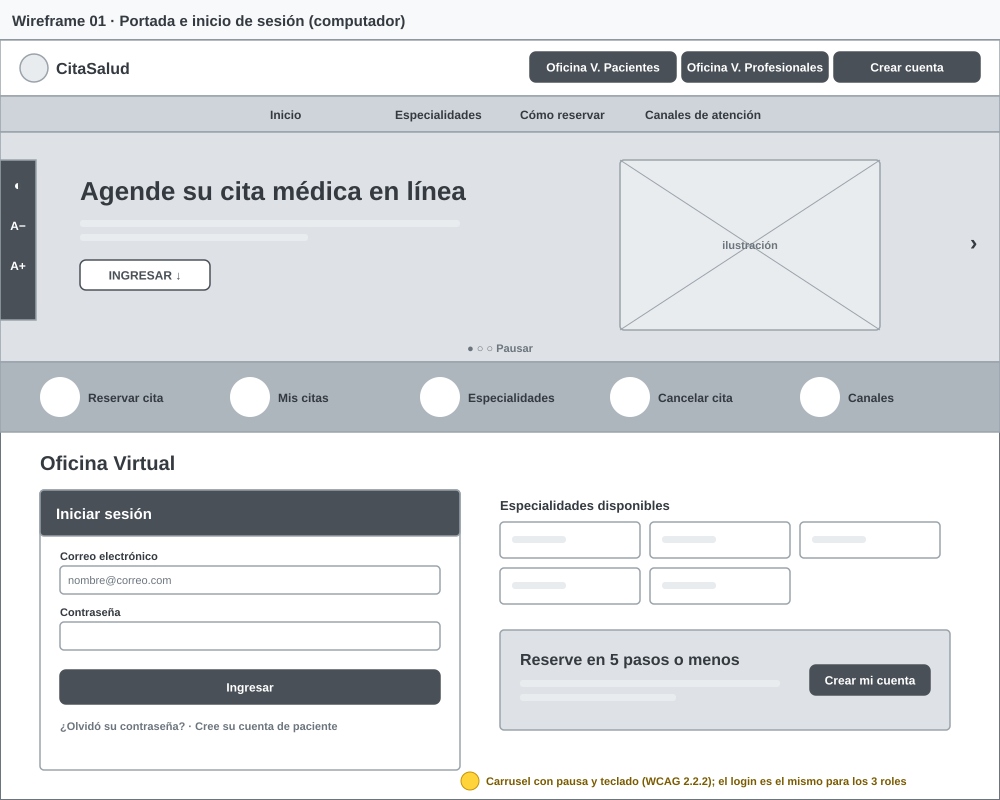
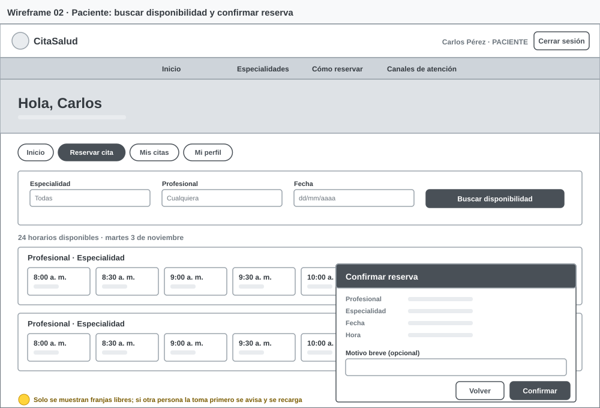
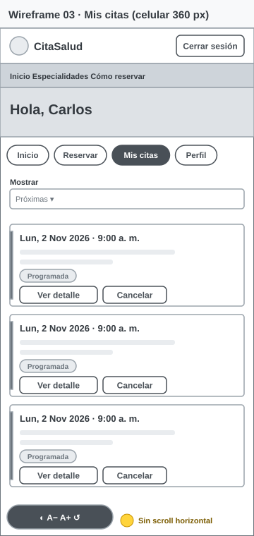
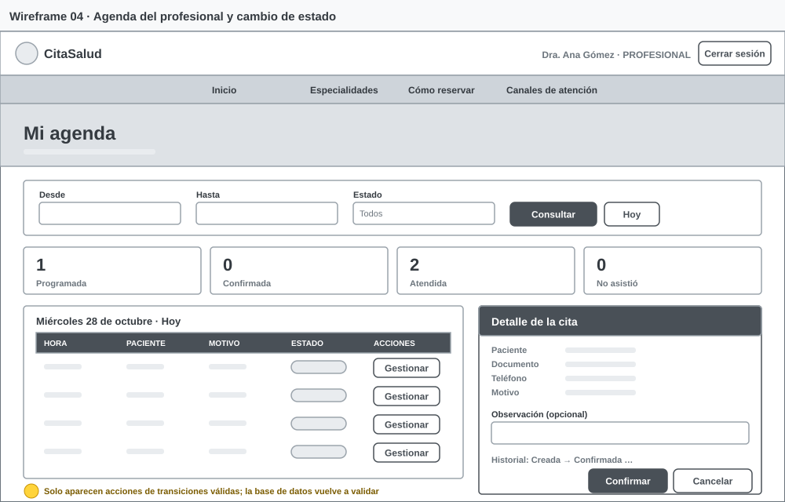
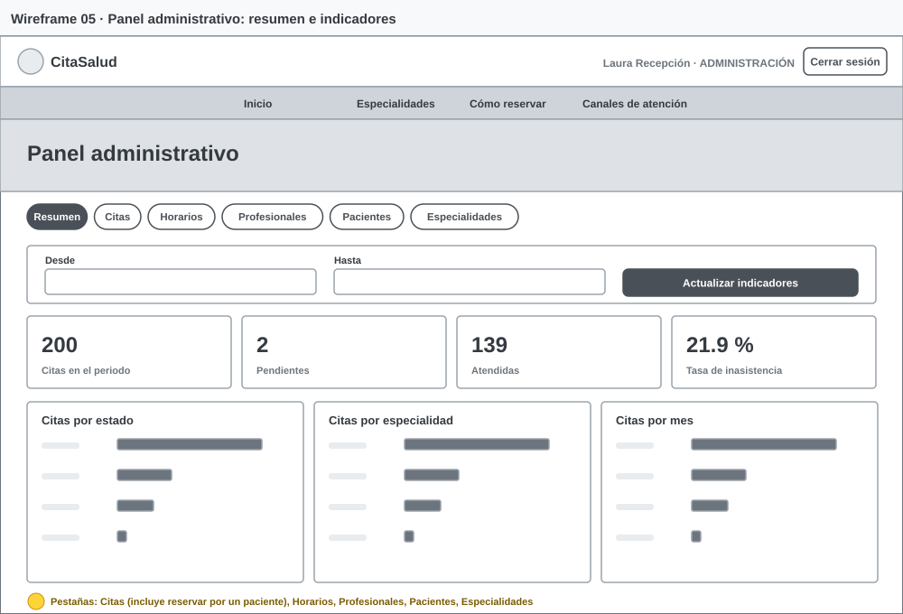
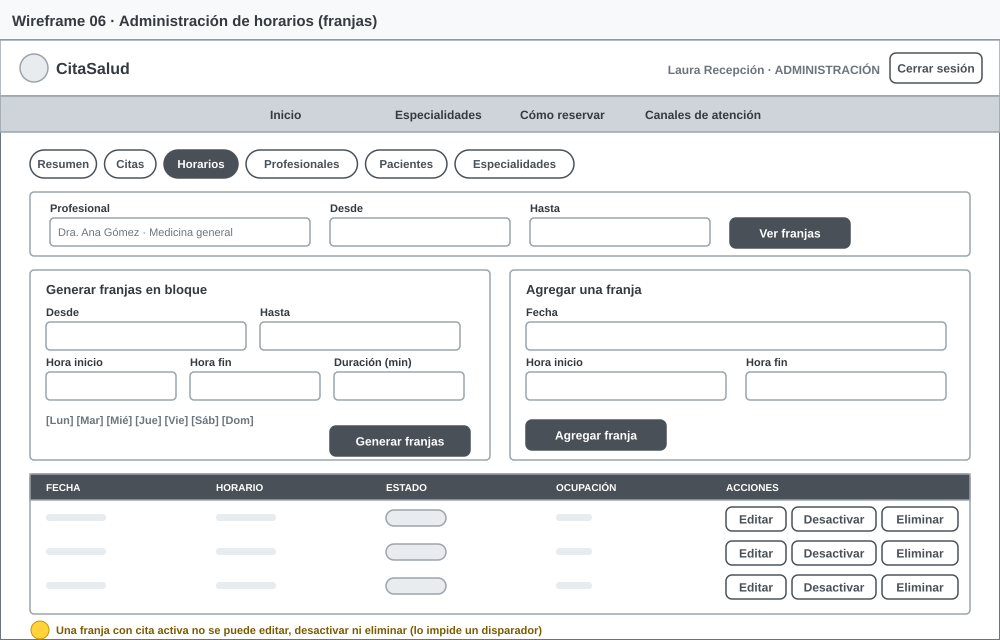

> Copia exportada del documento de análisis y diseño. Versión editable con diagramas interactivos: https://claude.ai/artifact/VVxc1xd5ydV3fb7vHpyVDB

# CitaSalud · Documento de análisis y diseño

Sistema web de reserva de citas médicas · IPS Ambulatoria Bienestar (ficticia) · Oct 22, 2026 · @Juan Ospino

## 1. Ficha del problema

CitaSalud centraliza en una sola agenda web la reserva, consulta, cancelación y administración de citas de una IPS ambulatoria ficticia, y garantiza en la base de datos que una franja nunca se asigne dos veces.

**Organización (ficticia).** IPS Ambulatoria Bienestar: una sede, 3 profesionales iniciales (Medicina general, Pediatría, Odontología), una recepcionista y cerca de 40 citas diarias. Hoy agenda por llamadas, WhatsApp y una hoja de cálculo compartida.

**Problema.** La agenda está dispersa en varios canales sin un registro único ni reglas comunes, lo que produce cruces de horarios, duplicados, inasistencias y falta de información para decidir.

| Causa | Efecto observable | Afectados |
| --- | --- | --- |
| Agenda repartida entre llamadas, mensajes y archivo | Dos pacientes citados a la misma hora con el mismo profesional | Pacientes, profesionales |
| Sin identificación única del paciente | Registros duplicados y datos de contacto desactualizados | Recepción |
| Disponibilidad solo se conoce llamando | Llamadas en espera, abandono, carga para recepción | Pacientes, recepción |
| Sin estados ni confirmación | Pacientes sin confirmar, inasistencias no medidas | Profesionales, dirección |
| Sin historial de cambios | No se sabe quién movió o canceló una cita | Dirección |
| Sin datos consolidados | Decisiones de horarios sin evidencia | Dirección |

**Objetivo general.** Desarrollar y desplegar un sistema web que permita a pacientes, profesionales y administración gestionar citas médicas sobre una agenda única, con reglas de negocio y seguridad aplicadas en la base de datos.

**Objetivos específicos (medibles).**

1. Eliminar la doble reserva: 0 franjas con más de una cita activa, verificado con prueba de concurrencia (CP-02).
2. Permitir que un paciente reserve en máximo 5 pasos después de iniciar sesión (RNF-03).
3. Restringir el acceso por rol: 100 % de las pruebas negativas de acceso rechazadas (CP-03, CP-04, CP-11 a CP-14).
4. Registrar el 100 % de los cambios de estado con usuario y fecha en el historial.
5. Ofrecer indicadores por estado, especialidad y mes, y la tasa de inasistencia, para cualquier rango de fechas.

**Alcance del MVP.** Registro e inicio de sesión, recuperación de contraseña, perfil básico, catálogo de especialidades y profesionales, franjas por profesional, búsqueda de disponibilidad, reserva, Mis citas, cancelación con anticipación mínima de 2 horas, agenda del profesional con cambio de estado, panel administrativo e indicadores.

**Exclusiones.** Historia clínica, diagnósticos, fórmulas, pagos, facturación, recordatorios por SMS/correo, varias sedes o consultorios, teleconsulta y reprogramación directa (se cancela y se reserva de nuevo).

**Restricciones.** HTML, CSS y JavaScript sin frameworks; GitHub Pages; Supabase en plan gratuito; equipo de 2 personas; solo datos ficticios.

**Supuestos.** Zona horaria única America/Bogota; cada franja la atiende un solo profesional; el paciente tiene correo electrónico; el profesional crea su cuenta y el administrador le asigna el rol.

**Criterios de éxito.** Aplicación publicada y funcional para los tres roles; scripts SQL que reconstruyen la base desde cero; todas las pruebas de alta prioridad aprobadas; requisitos de alta prioridad trazados hasta una prueba.

## 2. Investigación: comparación de dos plataformas

Ambas plataformas muestran disponibilidad real y confirmación activa; de ellas se toman la búsqueda por especialidad y fecha, la confirmación como estado explícito y la agenda única compartida entre canales. Fecha de consulta: 22/10/2026.

| Criterio | [Doctoralia](https://pro.doctoralia.es/productos/funcionalidades-populares/reserva-online-de-cita-0) (Docplanner) | [Zocdoc](https://www.zocdoc.com/resources/blog/article/how-zocdoc-works-for-patients/) | Decisión en CitaSalud |
| --- | --- | --- | --- |
| Búsqueda | Por especialidad y profesional; reserva 24/7 | Por condición o especialidad, aseguradora y ubicación | Filtros por especialidad, profesional y fecha (sin aseguradora ni ubicación: una sede) |
| Disponibilidad | Agenda sincronizada entre reserva en línea y teléfono | Calendario en tiempo real tomado de la agenda del profesional | Franjas publicadas por la IPS; la ocupación se calcula en la base de datos |
| Confirmación | Recepción llama y marca confirmar, cancelar o reprogramar | El paciente confirma por correo o SMS; reportan +15 % de asistencia | Estado «confirmada» lo marca el profesional o recepción; recordatorios fuera del MVP |
| Cancelación | Desde las opciones del personal; la página no describe reglas | La página no describe reglas | El paciente cancela en línea con ≥ 2 h de anticipación; después, por recepción |
| Datos solicitados | Base de pacientes sincronizada; declara cumplimiento GDPR/HIPAA | Carné de seguro y formularios de ingreso | Solo nombres, documento, teléfono y fecha de nacimiento opcional; nada clínico |
| Confianza | Opiniones verificadas | Reseñas verificadas | Fuera del alcance |

**Hallazgos.**

- La agenda única entre canales es la solución central de ambas: el teléfono y la web escriben en el mismo calendario. CitaSalud lo replica con el rol de recepción que reserva en nombre del paciente.
- Ninguna de las dos páginas consultadas explica cómo evita la doble reserva; en CitaSalud se resuelve con un índice único y bloqueo de fila, no con validación en el navegador.
- La confirmación reduce inasistencias; por eso se mide la tasa de inasistencia en los indicadores.
- Doctoralia reportaba en Colombia 80.000 citas mensuales en línea y más de 60.000 profesionales registrados ([Valora Analitik, 2021](https://www.valoraanalitik.com/?p=137167)), lo que confirma que el paciente colombiano ya usa la reserva web.
- Vacío detectado: las páginas no publican reglas de cancelación ni de cambios de horario con reservas existentes; CitaSalud las define de forma explícita (sección 10).

## 3. Modelo del proceso AS IS y TO BE

El cambio clave es dónde se decide si un horario está libre: hoy lo decide una persona mirando varias fuentes; en el proceso propuesto lo decide la base de datos en una sola operación atómica.

> **Diagrama:** Proceso AS IS y TO BE · agendamiento de citas. Véalo en la [versión en línea del documento](https://claude.ai/artifact/VVxc1xd5ydV3fb7vHpyVDB).

**AS IS.** El paciente llama o escribe; recepción revisa la hoja de cálculo y la agenda en papel, acuerda una hora y la anota. Como varias personas editan sin bloqueo, aparecen cruces y duplicados; no hay confirmación, historial ni datos para decidir.

**TO BE.** El paciente busca franjas libres por especialidad, profesional y fecha, elige una y confirma. `reservar_cita()` bloquea la franja y crea la cita; si otra persona la tomó primero, el paciente recibe un aviso y la lista se recarga. El profesional confirma y marca atendida o no asistió; cada cambio queda en el historial y alimenta los indicadores. Recepción sigue atendiendo llamadas, pero reserva en la misma agenda (RF-16).

## 4. Matriz de actores

Tres roles con permisos disjuntos: el paciente solo ve lo suyo, el profesional solo su agenda y el administrador gestiona catálogos y citas con trazabilidad.

| Actor | Necesidad | Responsabilidad | Permiso | Datos que usa |
| --- | --- | --- | --- | --- |
| Paciente | Conseguir cita sin llamar y saber su estado | Mantener datos de contacto; cancelar a tiempo | Leer/editar su perfil; buscar disponibilidad; reservar, ver y cancelar sus citas | Perfil propio, especialidades, profesionales activos, franjas libres, sus citas |
| Profesional de salud | Saber a quién atiende y registrar el resultado de la cita | Actualizar el estado de sus citas | Leer su perfil, sus franjas y citas; cambiar estado solo de citas asignadas | Agenda propia, nombre, documento y teléfono del paciente, motivo breve |
| Administrador / recepción | Controlar la agenda y medir la operación | Publicar especialidades, profesionales y franjas; atender por teléfono | Gestionar catálogos, franjas y todas las citas; reservar por un paciente; ver indicadores | Todas las tablas, historial e indicadores |
| Sistema (BD) | Garantizar reglas sin depender de la interfaz | Validar transiciones, impedir cruces y auditar | Disparadores y funciones RPC | Todas |

**Conflictos identificados y cómo se resuelven.**

- *Paciente vs. profesional:* el paciente quiere cancelar a última hora; el profesional pierde la franja. Regla: cancelación en línea solo con ≥ 2 h; después, por recepción.
- *Recepción vs. profesional:* recepción quiere mover horarios con citas ya tomadas. Regla: una franja con cita activa no se modifica ni desactiva hasta cancelar o atender la cita.
- *Privacidad vs. operación:* el profesional necesita contactar al paciente, pero no ver a otros. Regla: solo ve datos de pacientes de sus propias citas, a través de `listar_citas()`.

## 5. Riesgos del proyecto

El riesgo de mayor impacto es una regla de seguridad mal escrita; se trata con pruebas negativas automatizadas antes de cada entrega.

| Riesgo | Probabilidad | Impacto | Prevención | Respuesta |
| --- | --- | --- | --- | --- |
| R1. Política RLS permisiva expone citas ajenas | Media | Alto | RLS en las 6 tablas, privilegios revocados por defecto, script de pruebas negativas | Revocar el permiso, corregir la política y repetir CP-03/CP-04 |
| R2. Doble reserva por solicitudes simultáneas | Media | Alto | Índice único parcial + `SELECT … FOR UPDATE` en `reservar_cita()` | Mensaje de conflicto y recarga de disponibilidad (CP-02) |
| R3. Publicar la clave `service_role` en GitHub | Baja | Alto | Solo clave anon en `config.js`; `.gitignore` y revisión antes de cada push | Rotar claves en Supabase de inmediato y reescribir historial |
| R4. Errores de zona horaria (citas «pasadas» que no lo son) | Media | Medio | Función `inicio_local()` con America/Bogota en todas las comparaciones | Prueba de borde con franja a 1 h (CP-09) |
| R5. Retraso por curva de aprendizaje de Supabase/RLS | Alta | Medio | Hitos semanales; scripts SQL desde el Hito 3 | Recortar alcance no obligatorio (recordatorios, varias sedes) |
| R6. Participación desigual del equipo | Media | Medio | Tareas asignadas por módulo y commits frecuentes de ambos | Reasignar tareas y documentarlo en el README |
| R7. Límites del plan gratuito (pausa por inactividad) | Media | Bajo | Usar el proyecto al menos una vez por semana | Reactivar el proyecto antes de la sustentación |

## 6. Requisitos funcionales

Se especifican 19 requisitos, 15 de prioridad alta; cada uno tiene un criterio de aceptación verificable y al menos un caso de prueba (sección 12). Fuente: T = taller del docente; P = análisis del problema; I = investigación de plataformas.

| ID | Requisito | Actor | Prioridad | Fuente | Criterio de aceptación |
| --- | --- | --- | --- | --- | --- |
| RF-01 | El sistema permitirá registrarse como paciente con nombres, documento, teléfono, correo y contraseña | Paciente | Alta | T | Con datos válidos se crea la cuenta con rol paciente; un documento ya registrado se rechaza con mensaje claro |
| RF-02 | El sistema permitirá iniciar y cerrar sesión y dirigirá a cada usuario al panel de su rol | Todos | Alta | T | Credenciales válidas llevan al panel del rol; inválidas muestran «Correo o contraseña incorrectos»; abrir el panel de otro rol redirige al propio |
| RF-03 | El sistema permitirá solicitar un enlace de recuperación y crear una nueva contraseña | Todos | Media | T | El mensaje no revela si el correo existe; con el enlace se guarda la nueva contraseña y se vuelve al inicio |
| RF-04 | El paciente podrá consultar y actualizar su perfil sin datos clínicos | Paciente | Alta | T | Los cambios válidos se guardan; no puede modificar perfiles ajenos ni su propio rol |
| RF-05 | El sistema mostrará el catálogo de especialidades y profesionales activos | Todos | Alta | T | Solo aparecen registros activos; los inactivos no se ofrecen para reservar |
| RF-06 | El paciente buscará disponibilidad por especialidad, profesional y fecha | Paciente | Alta | T, I | Se listan solo franjas activas, futuras y sin cita activa, agrupadas por profesional |
| RF-07 | El paciente reservará una cita en una franja disponible | Paciente | Alta | T | Se crea una sola cita en estado programada y la franja deja de aparecer; fechas pasadas y franjas ocupadas se rechazan |
| RF-08 | El paciente consultará «Mis citas» con fecha, hora, profesional, especialidad y estado | Paciente | Alta | T | Solo se listan sus citas, filtrables en próximas, historial o todas |
| RF-09 | El paciente cancelará citas futuras con al menos 2 horas de anticipación | Paciente | Alta | T, I | Con ≥ 2 h la cita pasa a cancelada y la franja se libera; con menos se rechaza indicando acudir a recepción |
| RF-10 | El profesional consultará únicamente su agenda por rango de fechas y estado | Profesional | Alta | T | La consulta no retorna citas de otro profesional |
| RF-11 | El profesional cambiará el estado de sus citas según transiciones válidas | Profesional, admin | Alta | T | programada→confirmada/cancelada; confirmada→atendida/no asistió/cancelada; cualquier otra transición se rechaza |
| RF-12 | El administrador creará, editará, activará y desactivará especialidades | Admin | Alta | T | No se permiten nombres duplicados (sin distinguir mayúsculas); desactivar oculta la especialidad de la búsqueda |
| RF-13 | El administrador configurará franjas por profesional, fecha y hora, individualmente o en bloque, y las editará | Admin | Alta | T | No se crean franjas pasadas ni superpuestas; una franja con cita activa no se modifica |
| RF-14 | El administrador registrará, editará, activará y desactivará profesionales | Admin | Alta | T | Un usuario registrado se convierte en profesional con especialidad; no se desactiva si tiene citas futuras activas |
| RF-15 | El administrador consultará indicadores por estado, especialidad y periodo | Admin | Media | T, P | Para un rango de fechas se muestran totales y la tasa de inasistencia, coherentes con el listado de citas |
| RF-16 | Recepción podrá reservar una cita en nombre de un paciente | Admin | Media | I | La cita queda a nombre del paciente elegido y registra al administrador como creador |
| RF-17 | El sistema mostrará mensajes claros de éxito, error, validación y confirmación | Todos | Alta | T | Cada formulario señala el campo inválido; las acciones destructivas piden confirmación |
| RF-18 | El sistema registrará cada cambio de estado con usuario, fecha y observación | Sistema | Alta | T, P | Cada creación o cambio de estado genera una fila en el historial con el usuario autenticado |
| RF-19 | El administrador buscará, editará, activará, desactivará y anonimizará pacientes | Admin | Media | T | Los cambios se guardan con validación; un paciente inactivo no puede iniciar sesión; no se anonimiza si tiene citas futuras activas |

## 7. Requisitos no funcionales

Diez requisitos medibles; cada uno indica cómo se comprueba.

| ID | Categoría | Requisito verificable | Verificación |
| --- | --- | --- | --- |
| RNF-01 | Seguridad | Las 6 tablas tendrán RLS habilitado y políticas por rol o propietario; las escrituras críticas solo serán posibles mediante funciones RPC | Consulta a `pg_tables.rowsecurity`; CP-03, CP-04, CP-11 a CP-14 |
| RNF-02 | Rendimiento | La agenda de un día cargará en máximo 3 s con 500 citas de prueba bajo conexión estable | Medición en la pestaña Red del navegador; índices por fecha, profesional y paciente |
| RNF-03 | Usabilidad | Un paciente reservará en máximo 5 pasos tras iniciar sesión | Conteo: pestaña Reservar → especialidad → fecha → elegir hora → confirmar |
| RNF-04 | Compatibilidad | La interfaz será usable en las dos últimas versiones de Chrome y Firefox y a 360 px de ancho sin desplazamiento horizontal | CP-05 automatizado a 360 px y 1280 px |
| RNF-05 | Accesibilidad | Etiquetas asociadas a cada control, foco visible, navegación por teclado en pestañas y diálogos, contraste mínimo 4.5:1 en texto (WCAG 2.1 AA) | Revisión con Lighthouse y navegación solo con teclado |
| RNF-06 | Seguridad | Ningún dato proveniente de la base de datos se insertará con `innerHTML`; se usará `textContent` y creación de nodos | Búsqueda de `innerHTML` en el repositorio = 0 resultados |
| RNF-07 | Privacidad | Solo se almacenarán nombres, documento, teléfono, fecha de nacimiento opcional y un motivo de máximo 200 caracteres; ningún dato clínico | Diccionario de datos y restricciones CHECK de longitud |
| RNF-08 | Mantenibilidad | Presentación, lógica de interfaz y acceso a datos en módulos separados; ningún módulo de página llama a Supabase directamente | Revisión de importaciones: solo `api.js` usa el cliente |
| RNF-09 | Disponibilidad | Frontend en GitHub Pages y backend en Supabase, accesibles por HTTPS; la base se reconstruye con 3 scripts en menos de 5 minutos | Ejecución de los scripts en un proyecto nuevo |
| RNF-10 | Integridad | Roles y estados solo tomarán valores de tipos enumerados; ninguna franja tendrá dos citas activas aunque lleguen solicitudes simultáneas | Tipos `app_role` y `appointment_status`; CP-02 |

## 8. Casos de uso

Ocho casos detallados cubren los flujos críticos de los tres actores; el diagrama general aparece al final de esta sección.

### CU-01 Registrarse (RF-01)

- **Actor:** visitante. **Precondición:** no tiene cuenta con ese correo.
- **Flujo principal:** 1) abre «Crear cuenta»; 2) ingresa nombres, documento, teléfono, fecha de nacimiento opcional, correo y contraseña; 3) el sistema valida formatos; 4) Supabase Auth crea el usuario y el disparador crea su perfil con rol paciente; 5) ingresa a su panel o recibe el correo de confirmación.
- **Alternativas:** 5a) si el proyecto exige confirmación de correo, se muestra el aviso y no se inicia sesión.
- **Excepciones:** correo ya registrado; documento duplicado; contraseñas distintas o débiles.
- **Postcondición:** existe un usuario en `auth.users` y su fila en `profiles` con rol paciente.

### CU-02 Iniciar sesión (RF-02)

- **Actor:** todos. **Precondición:** cuenta activa.
- **Flujo principal:** 1) ingresa correo y contraseña; 2) el sistema autentica; 3) lee el perfil; 4) redirige al panel del rol.
- **Excepciones:** credenciales inválidas; cuenta inactiva (se cierra la sesión y se informa); sesión expirada (vuelve al inicio con aviso).
- **Postcondición:** sesión activa con token JWT.

### CU-03 Buscar disponibilidad y reservar cita (RF-06, RF-07)

- **Historia:** como paciente, quiero consultar franjas disponibles por especialidad para reservar una cita compatible con mi horario.
- **Precondición:** sesión iniciada, perfil con documento y teléfono, franjas publicadas.
- **Flujo principal:** 1) abre «Reservar cita»; 2) elige especialidad, profesional (opcional) y fecha; 3) el sistema muestra franjas libres; 4) elige una hora; 5) revisa el resumen y escribe un motivo breve opcional; 6) confirma; 7) el sistema crea la cita en estado programada y confirma con un aviso.
- **Alternativas:** 3a) no hay franjas: se sugiere otra fecha o profesional.
- **Excepciones:** 7a) otra persona reservó la franja antes de confirmar: el sistema informa el conflicto y actualiza la disponibilidad; 7b) el paciente ya tiene otra cita que se cruza; 7c) perfil incompleto.
- **Postcondición:** la reserva queda vinculada al paciente; la franja no se duplica; queda registro en el historial.

### CU-04 Consultar y cancelar mis citas (RF-08, RF-09)

- **Actor:** paciente. **Precondición:** tiene al menos una cita.
- **Flujo principal:** 1) abre «Mis citas»; 2) filtra próximas, historial o todas; 3) elige «Cancelar» en una cita futura; 4) escribe un motivo opcional; 5) confirma; 6) la cita pasa a cancelada y la franja queda libre.
- **Excepciones:** faltan menos de 2 horas: se rechaza y se indica comunicarse con recepción; la cita no es suya (no se muestra ni se puede modificar).
- **Postcondición:** estado cancelada con `cancelled_at`, `cancelled_by` y fila en historial.

### CU-05 Gestionar agenda del profesional (RF-10, RF-11)

- **Actor:** profesional. **Precondición:** perfil profesional activo.
- **Flujo principal:** 1) abre su agenda (hoy a +7 días por defecto); 2) filtra por fechas o estado; 3) abre «Gestionar»; 4) ve datos del paciente, motivo e historial; 5) elige una acción válida y una observación opcional; 6) confirma; 7) el estado cambia.
- **Alternativas:** 5a) antes de la hora solo se ofrece confirmar o cancelar; después de iniciada, atendida o no asistió.
- **Excepciones:** transición no permitida; cita de otro profesional (rechazada por la BD aunque se manipule el identificador).
- **Postcondición:** nuevo estado registrado en el historial con el profesional como autor.

### CU-06 Configurar franjas (RF-13)

- **Actor:** administrador. **Precondición:** profesional activo.
- **Flujo principal:** 1) abre «Horarios» y elige profesional; 2) define rango de fechas, hora inicio, hora fin, duración y días; 3) genera; 4) el sistema crea las franjas y reporta cuántas.
- **Alternativas:** 2a) agrega una franja individual; 2b) activa, desactiva o elimina una franja libre.
- **Excepciones:** franjas pasadas o superpuestas se omiten o rechazan; modificar o desactivar una franja con cita activa se rechaza.
- **Postcondición:** franjas disponibles en la búsqueda del paciente.

### CU-07 Gestionar especialidades y profesionales (RF-12, RF-14)

- **Actor:** administrador.
- **Flujo principal:** 1) crea o edita una especialidad; 2) busca a un usuario ya registrado; 3) le asigna especialidad y registro profesional; 4) el sistema cambia su rol a profesional.
- **Excepciones:** nombre de especialidad duplicado; usuario con citas activas como paciente; desactivar un profesional con citas futuras activas.
- **Postcondición:** catálogo actualizado; acciones asociadas al administrador autenticado (`created_by`).

### CU-08 Consultar indicadores (RF-15)

- **Actor:** administrador.
- **Flujo principal:** 1) abre «Resumen»; 2) elige rango de fechas; 3) el sistema muestra total de citas, pendientes, atendidas, tasa de inasistencia y barras por estado, especialidad y mes.
- **Excepciones:** rango inválido; usuario sin rol admin (la función lo rechaza).
- **Postcondición:** ninguna (solo lectura).

### Diagrama general

> **Diagrama:** Diagrama general de casos de uso · 3 actores, 8 casos. Véalo en la [versión en línea del documento](https://claude.ai/artifact/VVxc1xd5ydV3fb7vHpyVDB).

El administrador también usa CU-03 para reservar en nombre de un paciente que llama a recepción (RF-16).

## 9. Arquitectura y diseño de interfaz

Arquitectura cliente–nube de dos capas: GitHub Pages sirve archivos estáticos y toda regla de negocio y seguridad vive en Supabase (PostgreSQL + RLS + funciones), de modo que manipular el navegador no salta ningún control.

> **Diagrama:** Arquitectura cliente–nube · GitHub Pages + Supabase. Véalo en la [versión en línea del documento](https://claude.ai/artifact/VVxc1xd5ydV3fb7vHpyVDB).

El navegador descarga archivos estáticos de GitHub Pages; `api.js` envía cada petición con el JWT de la sesión y PostgreSQL decide con RLS y funciones qué puede hacer ese usuario.

| Componente | Responsabilidad |
| --- | --- |
| GitHub Pages | Publica HTML, CSS y JS por HTTPS; no ejecuta código de servidor |
| Navegador: páginas y `pages/*.js` | Pintar pantallas por rol, validar formularios, mostrar estados (cargando, vacío, error, éxito) |
| `api.js` | Única capa que habla con Supabase; traduce errores técnicos a mensajes en español |
| `auth.js` | Sesión, perfil y redirección por rol (solo decide qué pantalla ver, no autoriza) |
| `ui.js` | Creación segura de nodos (`textContent`), avisos, diálogos, pestañas accesibles, formatos de fecha |
| Supabase Auth | Registro, inicio de sesión, recuperación de contraseña, emisión de JWT |
| PostgREST (API) | Expone tablas y funciones RPC; pasa el JWT a PostgreSQL |
| PostgreSQL | Tablas, restricciones, disparadores, funciones `SECURITY DEFINER`, RLS |

**Mapa de navegación por rol.**

- Visitante: `index.html` (portada con carrusel, accesos rápidos e inicio de sesión) → `registro.html` · `recuperar.html`.
- Paciente: `paciente.html` con pestañas Inicio · Reservar cita (→ diálogo Confirmar reserva) · Mis citas (→ diálogo Detalle / Cancelar) · Mi perfil.
- Profesional: `profesional.html` → agenda por día (filtros) → diálogo Detalle de cita con historial y cambio de estado.
- Administrador: `admin.html` con pestañas Resumen (indicadores) · Citas (+ reserva por paciente) · Horarios · Profesionales · Pacientes · Especialidades.
- Cualquier rol que abra el panel de otro es redirigido a su propio panel con aviso de acceso denegado.

**Pantallas mínimas cubiertas.**

| Módulo | Pantallas o vistas implementadas |
| --- | --- |
| Acceso | Inicio de sesión, registro, solicitud de recuperación, nueva contraseña, cierre de sesión |
| Paciente | Inicio con próximas citas, buscar disponibilidad, confirmar reserva, mis citas, detalle, perfil |
| Profesional | Agenda propia con resumen por estado, detalle de cita con historial, cambio de estado |
| Administración | Resumen e indicadores, citas (y reserva por paciente), horarios (bloque, individual y edición), profesionales, pacientes, especialidades |

**Decisiones de interfaz.**

- Estilo de portal institucional de salud: barra superior con accesos a la Oficina Virtual, menú azul, carrusel con pausa, franja de accesos rápidos y pie de página oscuro. Paleta azul institucional con celeste y turquesa; tipografía Nunito Sans.
- Mobile-first: a menos de 760 px las tablas se convierten en tarjetas con etiqueta por campo, los indicadores van de a dos y no hay desplazamiento horizontal a 360 px.
- Jerarquía: un botón primario por vista; acciones destructivas en rojo y siempre con diálogo de confirmación.
- Estados visibles: indicador de carga, lista vacía con la siguiente acción sugerida, errores en lenguaje claro, insignias de estado con texto y punto de color (no solo color).
- Prevención de errores: fechas mínimas en los selectores, campos obligatorios marcados con `aria-invalid` y mensaje junto al campo, botones deshabilitados mientras se procesa.
- Accesibilidad: barra lateral con alto contraste y tamaño de letra (A−, A+, restablecer), enlace «Saltar al contenido», pestañas con `role=tab` y flechas del teclado, carrusel con pausa (WCAG 2.2.2), diálogos nativos `<dialog>` y foco visible.
- Las capturas de las pantallas están en `docs/capturas/` del repositorio.

### Wireframes

Se bocetaron seis pantallas en baja fidelidad antes de construir la interfaz; los archivos SVG están en `docs/wireframes/` del repositorio.

## 10. Modelo de datos

Seis tablas en tercera forma normal; la ocupación de una franja no se guarda, se deriva de si existe una cita no cancelada, lo que elimina inconsistencias entre franja y cita. Scripts: `sql/esquema.sql`, `sql/politicas_rls.sql`, `sql/datos_prueba.sql`.

**Relaciones.** `auth.users` 1–1 `profiles`; `profiles` 1–0..1 `professionals`; `specialties` 1–N `professionals`; `professionals` 1–N `schedules`; `schedules` 1–N `appointments` (máximo una activa); `profiles` (paciente) 1–N `appointments`; `appointments` 1–N `status_history`.

> **Diagrama:** Diagrama entidad–relación · 6 tablas. Véalo en la [versión en línea del documento](https://claude.ai/artifact/VVxc1xd5ydV3fb7vHpyVDB).

`auth.users` (Supabase Auth) guarda las credenciales y se enlaza 1 a 1 con `profiles` por el mismo UUID; `appointments.professional_id` lo copia un disparador desde la franja para que no pueda contradecirla.

### Diccionario de datos

| Tabla | Campo | Tipo | Restricciones | Descripción |
| --- | --- | --- | --- | --- |
| profiles | id | uuid | PK, FK → auth.users ON DELETE CASCADE | Mismo id del usuario de Auth |
| profiles | nombres | text | NOT NULL, 3–120 caracteres | Nombre completo |
| profiles | documento | text | UNIQUE, solo dígitos 5–15 | Documento ficticio; obligatorio para reservar |
| profiles | telefono | text | `+` opcional y 7–15 dígitos | Contacto |
| profiles | fecha\_nacimiento | date | ≥ 1900-01-01 y ≤ hoy (disparador) | Opcional |
| profiles | rol | app\_role | NOT NULL, enum, default paciente | paciente, profesional, admin |
| profiles | activo / created\_at / updated\_at | boolean / timestamptz | NOT NULL | Borrado lógico y auditoría |
| specialties | id | uuid | PK |  |
| specialties | nombre | text | NOT NULL, índice único sobre `lower(btrim(nombre))` | Sin duplicados por mayúsculas o espacios |
| specialties | descripcion | text | ≤ 300 |  |
| specialties | activo / created\_at / created\_by | boolean / timestamptz / uuid | created\_by FK → profiles, default `auth.uid()` | Quién la creó |
| professionals | id | uuid | PK |  |
| professionals | profile\_id | uuid | NOT NULL, UNIQUE, FK → profiles RESTRICT | Un perfil = un profesional |
| professionals | specialty\_id | uuid | NOT NULL, FK → specialties RESTRICT, índice |  |
| professionals | registro\_profesional | text | UNIQUE, 3–30 | Opcional, ficticio |
| professionals | activo / created\_at / created\_by |  |  |  |
| schedules | id | uuid | PK | Franja horaria |
| schedules | professional\_id | uuid | NOT NULL, FK → professionals RESTRICT |  |
| schedules | fecha, hora\_inicio, hora\_fin | date, time, time | NOT NULL; fin > inicio; duración 10 min–4 h | Hora local de Bogotá |
| schedules | activo | boolean | NOT NULL | Desactivar oculta la franja |
| schedules | (restricción) | EXCLUDE GiST | `professional_id =` y `tsrange &&` cuando activo | Un profesional sin franjas superpuestas |
| appointments | id | uuid | PK | Cita |
| appointments | patient\_id | uuid | NOT NULL, FK → profiles RESTRICT, índice | Paciente |
| appointments | professional\_id | uuid | NOT NULL, FK, índice; lo asigna el disparador desde la franja |  |
| appointments | schedule\_id | uuid | NOT NULL, FK RESTRICT; índice único parcial `WHERE estado <> 'cancelada'` | Anti doble reserva |
| appointments | motivo | text | ≤ 200 | Motivo breve, sin datos clínicos |
| appointments | estado | appointment\_status | NOT NULL, default programada, índice | programada, confirmada, atendida, cancelada, no\_asistio |
| appointments | observaciones | text | ≤ 500 | Observación administrativa |
| appointments | created\_at, created\_by, updated\_at |  | created\_by default `auth.uid()` |  |
| appointments | cancelled\_at, cancelled\_by | timestamptz, uuid | CHECK: `(estado = 'cancelada') = (cancelled_at IS NOT NULL)` |  |
| status\_history | id | bigint identity | PK |  |
| status\_history | appointment\_id | uuid | NOT NULL, FK CASCADE, índice |  |
| status\_history | estado\_anterior, estado\_nuevo | appointment\_status | estado\_nuevo NOT NULL | Null en la creación |
| status\_history | observacion, changed\_by, changed\_at | text, uuid, timestamptz | changed\_by = `auth.uid()` | Auditoría |

### Decisiones de integridad

1. **Doble reserva:** índice único parcial sobre `schedule_id` para citas no canceladas, más `SELECT … FOR UPDATE` de la franja en `reservar_cita()`. La validación en JavaScript es solo ayuda visual.
2. **Franja al cancelar:** la franja se conserva y no cambia; la cita pasa a cancelada, deja de contar para el índice único y la franja vuelve a aparecer libre. Se preserva el historial.
3. **Valores cerrados:** `app_role` y `appointment_status` son tipos enumerados; las transiciones se validan con `transicion_valida()` en un disparador.
4. **Auth separado:** `auth.users` guarda credenciales; `profiles` guarda datos públicos, enlazados por el mismo UUID.
5. **Borrado:** llaves foráneas con RESTRICT; borrado lógico con `activo`; `anonimizar_paciente()` reemplaza nombre y borra documento, teléfono y fecha de nacimiento conservando las citas para estadística.
6. **Cambios de horario con reservas:** un disparador impide mover, desactivar o eliminar una franja con cita activa, y desactivar un profesional con citas futuras activas.

## 11. Seguridad y configuración de Supabase

Seguridad en tres capas: privilegios de tabla revocados por defecto, RLS en las 6 tablas y funciones RPC que validan rol y reglas; el frontend solo lleva la clave anon pública.

### Matriz rol – recurso – operación (acceso directo a tablas)

| Recurso | Anónimo | Paciente | Profesional | Administrador |
| --- | --- | --- | --- | --- |
| profiles | — | SELECT/UPDATE solo el propio (sin cambiar rol ni activo) | SELECT/UPDATE solo el propio | SELECT/UPDATE todos |
| specialties | SELECT activas | SELECT activas | SELECT activas | SELECT todas, INSERT, UPDATE |
| professionals | — | — (catálogo por RPC) | SELECT el propio | SELECT, INSERT, UPDATE |
| schedules | — | — (disponibilidad por RPC) | SELECT las propias | SELECT, INSERT, UPDATE, DELETE (sin cita activa) |
| appointments | — | SELECT las propias | SELECT las asignadas | SELECT todas; UPDATE solo columna `observaciones` |
| status\_history | — | SELECT de sus citas | SELECT de sus citas | SELECT todo |

Nadie tiene INSERT ni DELETE directo sobre `appointments` ni escritura sobre `status_history`; ningún rol tiene DELETE sobre `profiles`, `specialties` ni `professionals`.

### Funciones RPC y quién puede usarlas

| Función | Paciente | Profesional | Admin | Control interno |
| --- | --- | --- | --- | --- |
| `catalogo_profesionales()` | Sí | Sí | Sí | También anónimo; solo activos |
| `buscar_disponibilidad()` | Sí | Sí | Sí | Exige sesión; solo franjas libres y futuras |
| `reservar_cita()` | Para sí | No | Para un paciente | Perfil completo, bloqueo de franja, sin cruces del paciente |
| `cambiar_estado_cita()` / `cancelar_cita()` | Solo cancelar las propias con ≥ 2 h | Sus citas, transiciones válidas | Todas | Mismo mensaje si no existe o no es suya |
| `listar_citas()` / `historial_cita()` | Las propias | Las asignadas | Todas | Filtro por rol dentro de la función |
| `generar_franjas()`, `registrar_profesional()`, `indicadores()`, `anonimizar_paciente()` | No | No | Sí | `es_admin()` |

### Controles adicionales

- Las funciones son `SECURITY DEFINER` con `search_path = public` fijo para evitar secuestro de funciones.
- El rol nunca viene del cliente: el disparador de registro asigna paciente; `tg_proteger_perfil` impide que un usuario cambie su rol o estado.
- Un perfil inactivo pierde todo acceso porque `app_rol()` devuelve nulo.
- `config.js` contiene solo la URL y la clave anon; no hay `service_role` en el repositorio; `.gitignore` excluye `.env` y se entrega `.env.example` sin secretos.
- En la interfaz no se usa `innerHTML`; los filtros de búsqueda eliminan caracteres especiales de la sintaxis de PostgREST.
- Supabase Auth: configurar *Site URL* y *Redirect URLs* con la URL de GitHub Pages; contraseñas de mínimo 8 caracteres.
- Todos los datos son ficticios (dominio `citasalud.test`).

## 12. Plan de pruebas

28 casos ejecutados, 28 aprobados en entorno local (PostgreSQL 16 con emulación de `auth`, PostgREST 12 y Playwright en Chromium a 1280 y 360 px). Deben repetirse contra el proyecto Supabase real antes de la entrega y adjuntar capturas. Datos: cuentas demo de `datos_prueba.sql`.

| ID | Escenario | Req. | Datos | Resultado esperado | Resultado obtenido | Estado |
| --- | --- | --- | --- | --- | --- | --- |
| CP-01 | Paciente reserva una franja libre | RF-06, RF-07 | paciente1, Pediatría, día hábil +4 | Se crea una única cita y desaparece la disponibilidad | Cita creada; franjas visibles 7 → 6 | Aprobado |
| CP-02 | Dos sesiones reservan la misma franja a la vez | RF-07, RNF-10 | paciente1 y paciente2 en paralelo | Solo una se confirma; la otra recibe conflicto controlado | Una reserva; la otra: «La franja acaba de ser reservada…»; 1 fila en BD | Aprobado |
| CP-03 | Paciente altera el ID para ver una cita ajena | RF-08, RNF-01 | paciente2 con id de cita de paciente1 | La política deniega y no retorna datos | SELECT y `listar_citas` 0 filas; `historial_cita` rechazado | Aprobado |
| CP-04 | Profesional actualiza cita de otro profesional | RF-11, RNF-01 | dr.ruiz sobre cita de dra.gomez | Operación rechazada | «Cita no encontrada o sin permiso…»; 0 filas visibles | Aprobado |
| CP-05 | Pantalla móvil de 360 px | RNF-04 | Portada, paciente, reserva, admin | Sin desplazamiento horizontal; controles usables | `scrollWidth ≤ innerWidth` en las 5 vistas | Aprobado |
| CP-06 | Reservar una franja en fecha pasada | RF-07 | Franja de hace 3 días | Rechazo | «La franja … ya no está disponible» | Aprobado |
| CP-07 | Paciente cancela su cita con ≥ 2 h | RF-09, RF-18 | paciente1, cita futura | Cancelada, franja libre, historial | Estado cancelada; historial programada→confirmada→cancelada con autores | Aprobado |
| CP-08 | Franja liberada vuelve a reservarse | RF-07 | paciente2 sobre la franja cancelada | Reserva exitosa | Reserva creada | Aprobado |
| CP-09 | Cancelar cita que inicia en 1 h | RF-09 | paciente2; luego admin | Paciente rechazado; admin permitido | «Solo puede cancelar con al menos 2 horas…»; admin cancela | Aprobado |
| CP-10 | Transiciones inválidas | RF-11 | confirmada→programada; atendida antes de la hora | Rechazo | «Transición de estado no permitida»; «Solo se puede marcar como atendida cuando…» | Aprobado |
| CP-11 | Paciente inserta cita o cambia estado por API directa | RNF-01 | INSERT/UPDATE sobre appointments | Rechazo | `permission denied for table appointments` | Aprobado |
| CP-12 | Paciente intenta asignarse rol admin | RF-04, RNF-01 | UPDATE profiles.rol | Rechazo | «No tiene permiso para cambiar el rol…» | Aprobado |
| CP-13 | Visitante sin sesión | RNF-01 | rol anon | Ve especialidades; no perfiles ni reserva | 5 especialidades; perfiles y `reservar_cita` denegados | Aprobado |
| CP-14 | Paciente abre el panel admin o pide indicadores | RF-02, RF-15 | paciente1 | Redirección y rechazo | Redirigido a paciente.html con aviso; `indicadores()` rechazado | Aprobado |
| CP-15 | Admin crea franja superpuesta | RF-13 | 10:15–10:45 sobre 10:00–10:30 | Rechazo | Violación de `schedules_sin_solape_ex` | Aprobado |
| CP-16 | Admin desactiva franja con cita activa | RF-13 | Franja reservada | Rechazo | «La franja tiene una cita activa…» | Aprobado |
| CP-17 | Generar franjas en bloque dos veces | RF-13 | 14:00–17:00, 20 min, 20 días | Primera crea; segunda no duplica | 126 creadas; luego 0 | Aprobado |
| CP-18 | Especialidad duplicada | RF-12 | «Nutrición» y «nutrición » | Segunda rechazada | «Ya existe una especialidad con ese nombre» | Aprobado |
| CP-19 | Registro con documento duplicado y luego válido | RF-01 | Documento 1000000005 | Rechazo; luego ingreso como paciente | Error claro; registro válido redirige a paciente.html | Aprobado |
| CP-20 | Inicio de sesión con clave incorrecta | RF-02, RF-17 | paciente1 + clave errónea | Mensaje claro | «Correo o contraseña incorrectos» | Aprobado |
| CP-21 | Indicadores del periodo | RF-15 | −30 a +14 días | Totales por estado, especialidad y mes | 201 citas; inasistencia 21,9 %; 3 gráficos | Aprobado |
| CP-22 | Recepción reserva por un paciente | RF-16 | admin para paciente2 | Cita a nombre del paciente | Aviso «Cita reservada…» y cita listada | Aprobado |
| CP-23 | Validaciones del cliente | RF-17 | Teléfono «abc»; fecha 2020-01-01 | Campo marcado con mensaje | `aria-invalid=true` y mensaje junto al campo | Aprobado |
| CP-24 | Profesional ve solo su agenda y confirma | RF-10, RF-11 | dra.gomez | Solo sus citas; confirmación registrada | 0 citas de otros; estado confirmada | Aprobado |
| CP-25 | Admin busca y edita un paciente | RF-19 | Búsqueda «María», teléfono «abc» y luego «3007778899» | Validación en el campo; luego datos guardados | Campo marcado; teléfono actualizado en la base de datos | Aprobado |
| CP-26 | Admin desactiva y reactiva un paciente | RF-19, RNF-01 | paciente2 | Pasa a la lista de inactivos y vuelve a activos | Filtro «Inactivos» muestra 1; reactivado con aviso | Aprobado |
| CP-27 | Anonimizar paciente con citas futuras | RF-19 | paciente1 con 2 citas futuras | Rechazo | «El paciente tiene citas futuras activas» | Aprobado |
| CP-28 | Admin edita una franja libre | RF-13 | Franja libre → 13:00–13:30 | Franja actualizada; franjas con cita activa no muestran «Editar» | «Franja actualizada» | Aprobado |

**Correcciones documentadas durante las pruebas.**

- CP-12 falló en la primera ejecución: el disparador que protege el rol era `SECURITY DEFINER` y veía al dueño de la función en lugar del usuario real. Se quitó `SECURITY DEFINER` de ese disparador y la prueba pasó.
- CP-13 falló al principio: la política de especialidades llamaba `es_admin()` sin permiso para anon. Se otorgó `EXECUTE` de las funciones de rol a anon.
- Al cerrar sesión se producían dos redirecciones simultáneas; se añadió una bandera para que solo redirija el botón.

Scripts: `pruebas/pruebas_reglas_seguridad.sql` (CP-02 a CP-04, CP-06 a CP-17) y `pruebas/e2e/e2e.js` (CP-01, CP-05, CP-07, CP-14, CP-18 a CP-24).

## 13. Matriz de trazabilidad

Los 15 requisitos de prioridad alta llegan hasta al menos una prueba aprobada.

| Necesidad | Requisito | Diseño (CU / pantalla) | Implementación (tabla, función, política) | Prueba |
| --- | --- | --- | --- | --- |
| Identificar al paciente sin duplicados | RF-01 | CU-01 · registro.html | `tg_crear_perfil`, `profiles.documento UNIQUE` | CP-19 |
| Acceso solo a lo autorizado | RF-02 | CU-02 · index.html, `auth.js` | Supabase Auth, `app_rol()`, RLS | CP-14, CP-20 |
| Recuperar acceso | RF-03 | recuperar.html | `resetPasswordForEmail`, `updateUser` | Manual en Supabase real |
| Datos de contacto al día | RF-04 | Paciente · Mi perfil | `profiles_update_propio_o_admin`, `tg_proteger_perfil` | CP-12, CP-23 |
| Saber qué se ofrece | RF-05 | Portada, filtros de reserva | `specialties_select_activas`, `catalogo_profesionales()` | CP-13 |
| Consultar disponibilidad sin llamar | RF-06 | CU-03 · Reservar cita | `buscar_disponibilidad()` | CP-01 |
| Evitar cruces de horario | RF-07 | CU-03 · diálogo Confirmar reserva | `reservar_cita()` + `appointments_franja_activa_uk` + `FOR UPDATE` | CP-01, CP-02, CP-06, CP-08 |
| Ver mis citas | RF-08 | CU-04 · Mis citas | `listar_citas()`, `appointments_select_participantes` | CP-03 |
| Liberar horarios a tiempo | RF-09 | CU-04 · detalle de cita | `cambiar_estado_cita()`, `horas_minimas_cancelacion()` | CP-07, CP-09 |
| Agenda del profesional | RF-10 | CU-05 · profesional.html | `listar_citas()` filtrado por `mi_professional_id()` | CP-04, CP-24 |
| Estados confiables | RF-11 | CU-05 · detalle de cita | `transicion_valida()`, `tg_validar_cita` | CP-04, CP-10, CP-24 |
| Catálogo ordenado | RF-12 | CU-07 · Especialidades | `specialties_nombre_uk`, políticas admin | CP-18 |
| Publicar horarios sin cruces | RF-13 | CU-06 · Horarios | `generar_franjas()`, `schedules_sin_solape_ex`, `tg_validar_franja` | CP-15, CP-16, CP-17 |
| Gestionar personal médico | RF-14 | CU-07 · Profesionales | `registrar_profesional()`, `tg_validar_profesional` | E2E «Listado de profesionales»; registro de un nuevo profesional: pendiente en Supabase real |
| Decidir con datos | RF-15 | CU-08 · Resumen | `indicadores()` | CP-21, CP-14 |
| Atender al paciente por teléfono | RF-16 | Admin · Citas · Reservar por paciente | `reservar_cita(p_patient_id)` | CP-22 |
| Mensajes claros | RF-17 | Todas las pantallas | `traducirError()`, `validarFormulario()` | CP-20, CP-23 |
| Saber quién cambió qué | RF-18 | Detalle de cita · historial | `status_history`, `tg_historial_cita` | CP-07 |
| Mantener datos de pacientes y su privacidad | RF-19 | Admin · Pacientes | profiles\_update\_propio\_o\_admin, tg\_proteger\_perfil, anonimizar\_paciente() | CP-25, CP-26, CP-27 |

## 14. Anexo: bitácora de fuentes e IA y referencias

Se usó un asistente de IA (Claude) para generar un primer borrador del esquema, el código y este documento; el equipo debe revisar, probar y poder explicar cada parte antes de la sustentación, y completar esta bitácora con sus propias verificaciones.

| Fecha | Herramienta o fuente | Propósito | Qué se utilizó | Cómo se verificó |
| --- | --- | --- | --- | --- |
| 22/10/2026 | Claude (asistente de IA) | Borrador de esquema SQL, políticas RLS, frontend y documento | Estructura de tablas, funciones RPC, módulos JS | 24 pruebas automatizadas en PostgreSQL 16 + PostgREST + Playwright; 3 defectos encontrados y corregidos (sección 12) |
| 22/10/2026 | Claude | Sugerencia descartada: guardar disponibilidad como columna `estado` en `schedules` | Se descartó: duplicaba información y podía desincronizarse; se derivó de las citas | Revisión del modelo y CP-07/CP-08 |
| 22/10/2026 | Documentación de PostgreSQL | Restricciones de exclusión y `ON CONFLICT DO NOTHING` | Franjas sin solapamiento | CP-15 y CP-17 |
| 22/10/2026 | [Doctoralia](https://pro.doctoralia.es/productos/funcionalidades-populares/reserva-online-de-cita-0), [Zocdoc](https://www.zocdoc.com/resources/blog/article/how-zocdoc-works-for-patients/) | Comparación de plataformas | Patrones de agenda única y confirmación | Lectura directa de las páginas |
| dd/mm | *(equipo)* Documentación oficial de Supabase | Comprender RLS y Auth | *(completar)* | Prueba con dos cuentas en el proyecto real |

**Referencias.**

- Supabase. Row Level Security, Auth y JavaScript client (supabase.com/docs).
- GitHub. GitHub Pages documentation (docs.github.com/pages).
- PostgreSQL Global Development Group. PostgreSQL 16 Documentation: Constraints, Triggers, Row Security Policies.
- MDN Web Docs. HTML forms, `<dialog>`, ARIA tabs, DOM `textContent`.
- OWASP. Top 10 (2021) y Cross Site Scripting Prevention Cheat Sheet.
- W3C WAI. Web Content Accessibility Guidelines (WCAG) 2.1.
- Docplanner/Doctoralia. [Reserva online de cita](https://pro.doctoralia.es/productos/funcionalidades-populares/reserva-online-de-cita-0). Consultado el 22/10/2026.
- Zocdoc. [How Zocdoc Works for Patients](https://www.zocdoc.com/resources/blog/article/how-zocdoc-works-for-patients/). Consultado el 22/10/2026.
- Valora Analitik (2021). [Doctoralia agenda mensualmente más de 80 mil citas médicas por internet en Colombia](https://www.valoraanalitik.com/?p=137167). Consultado el 22/10/2026.
